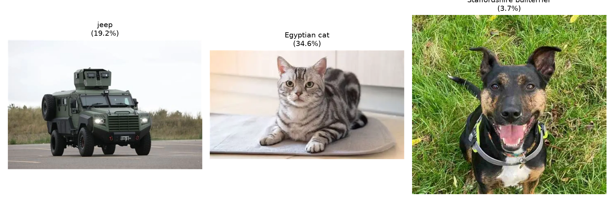

# CodeOrbit Image Classification Pipeline

## Project Overview & Purpose
An end-to-end computer vision inference pipeline built in PyTorch using transfer learning weights from a pretrained **MobileNetV2** Convolutional Neural Network (CNN) trained on ImageNet (1.2M images across 1,000 object categories). Processes local image directories, ranks Top-3 predictions with calibrated confidence scores, and generates a composite visual summary (`results.png`).

---

## How It Works (Pretrained CNN Transfer Learning)
1. **Model & Weight Initialization:** Loads `mobilenet_v2(weights=MobileNet_V2_Weights.DEFAULT)` in evaluation mode (`model.eval()`), locking batch normalization statistics and disabling dropout.
2. **Input Standardization:** Converts every image via Pillow `.convert("RGB")` so grayscale, RGBA (transparent PNG), and RGB photos conform uniformly to 3 color channels.
3. **Bundled Preprocessing Transforms:** Applies `weights.transforms()` to resize, center-crop to `224 × 224`, convert pixels to floating-point tensors, and normalize using exact ImageNet channel means and standard deviations, then adds a batch dimension (`[1, 3, 224, 224]`).
4. **No-Grad Inference & Softmax:** Runs the forward pass inside `with torch.no_grad():` to eliminate autograd memory overhead, applies `torch.softmax(logits[0], dim=0)` so class scores sum to `1.0`, and extracts the Top-3 labels using `torch.topk()`.
5. **Batch Visualization:** Gracefully skips corrupt or non-image files and saves a Matplotlib grid of the classified images and Top-1 confidence badges to `results.png`.

---

## Setup & How to Run

1. Navigate into the project directory:
   ```bash
   cd CodeOrbit_ImageClassification
   ```
2. Activate the virtual environment (or create one and install dependencies):
   - **Windows PowerShell:**
     ```powershell
     .\.venv\Scripts\Activate.ps1
     ```
   - **Git Bash / Linux / macOS:**
     ```bash
     source .venv/Scripts/activate
     ```
   *(If setting up a fresh environment, install packages with CPU PyTorch wheels:)*
   ```bash
   pip install -r requirements.txt --extra-index-url https://download.pytorch.org/whl/cpu
   ```
3. Place `.jpg`, `.jpeg`, `.png`, `.bmp`, or `.webp` images inside `images/` (sample `car.png`, `cat.png`, and `dog.png` are included) and run:
   ```bash
   python classify.py
   ```

---

## Example Output

```text
Loading MobileNetV2 pretrained model and ImageNet weights...
Model initialized successfully.

Found 3 image(s) in 'images'. Starting inference...

============================================================
Image: car.png
  Top-1: jeep                      (19.24%)
  Top-2: half track                (7.16%)
  Top-3: tow truck                 (4.19%)
------------------------------------------------------------
Image: cat.png
  Top-1: Egyptian cat              (34.56%)
  Top-2: tabby                     (18.05%)
  Top-3: tiger cat                 (4.88%)
------------------------------------------------------------
Image: dog.png
  Top-1: Staffordshire bullterrier (3.71%)
  Top-2: kelpie                    (3.34%)
  Top-3: Mexican hairless          (2.88%)
------------------------------------------------------------

Visual inference summary saved to 'results.png'.
```


